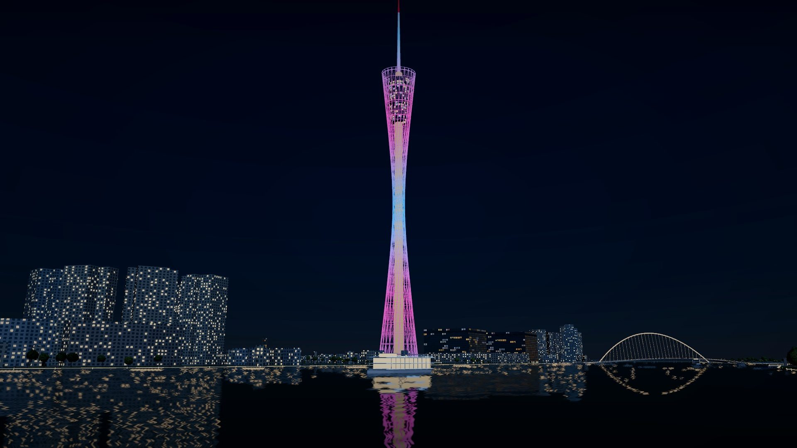
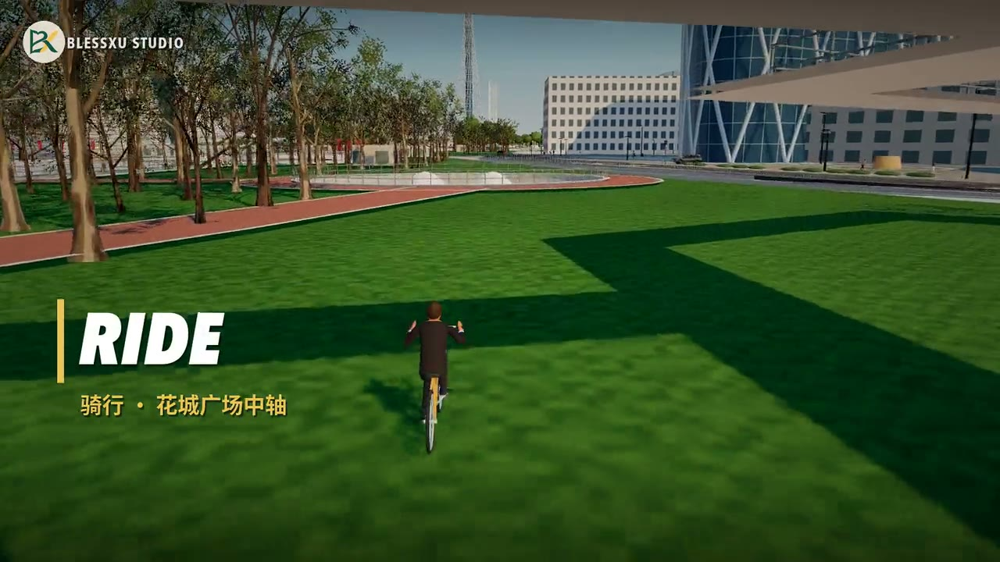
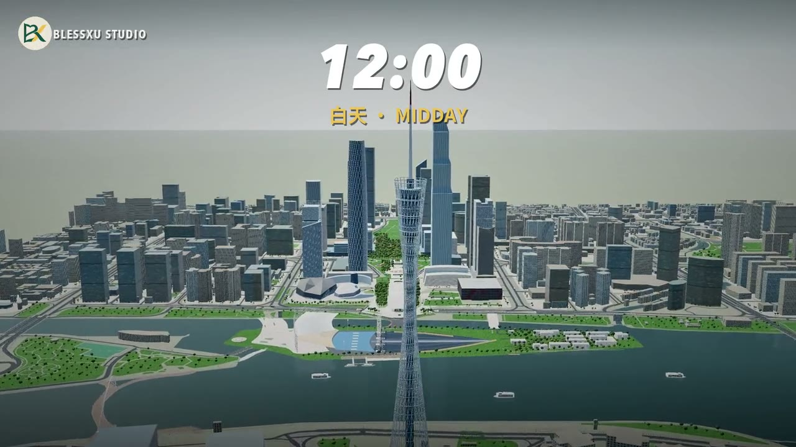

# Slop Guangzhou · 广州珠江新城

基于 Three.js、WebGPU / WebGL 2 和真实地理数据的广州珠江新城 3D 城市漫游，参考并适配 [Slop New York](https://github.com/mrdoob/slop-newyork)。

**[在线体验](https://blessxu.cn/project/zhujiang-city/)** · [GitHub](https://github.com/dearfaint/slop-guangzhou)

## 功能

- 花城广场、珠江、海心沙、广州塔、东西塔、广州大剧院及珠江公园等城市景观。
- 步行、驾驶、骑行、直升机，第一／第三人称与全览镜头。
- 动态车辆与行人、连续昼夜、合成空间音效和可交互小地图。
- OSM / Overture 城市轮廓、道路及水域；36 个地图分块随仓库提供，运行无需在线地图 API 或密钥。

这是用于体验与创作的城市模拟。地标外形、建筑缺失高度、设施位置和交通规则存在估算，不是逐栋测绘复刻，也不适用于导航或工程用途。桌面浏览器体验较好；手机性能和手感仍需真机验证。

## 数据真实性与已知缺陷

**真实地图轮廓不等于真实三维还原。绝大多数建筑高度仍为推算或默认值，不能据此判断真实天际线。**

场景内容按依据区分为三种情况，同一对象可能同时包含多种：

| 类型 | 项目中的情况 | 应如何理解 |
| --- | --- | --- |
| 直接采用公开数据 | OSM / Overture 的建筑轮廓、道路中心线、水域边界及已有属性 | 有地图数据依据，但源数据、裁剪和转换仍可能有误差 |
| 参照实际地图／影像近似建模 | 对照地图、卫星图和实景照片细化花城广场、海心沙桥路、地标外形及景观分布 | 参照现实布局制作，尺寸、高程和细节仍含人工推断，不等于测绘还原 |
| 缺数据时按规则估算 | 默认 18 米建筑、楼层乘假定层高、规则生成的设施与交通行为 | 用于补全场景，不应据此认定现场实际情况 |

“模拟”不表示全部凭空生成。例如一栋建筑可以使用实际地图轮廓，同时采用统一 18 米估高；一处桥路可以参考真实平面布局，同时估算其高程。

以下对仓库随附的 2026-10-28 数据快照逐条统计，合计 **3,271 条建筑／部件记录**，不是 3,271 栋独立建筑：

| 高度依据 | 记录数 | 占比 | 限制 |
| --- | ---: | ---: | --- |
| OSM / Overture 的高度字段 | 55 | 1.68% | 有来源高度值，未逐栋实测核验 |
| 设计方、CTBUH 等参考资料高度 | 13 | 0.40% | 人工选用资料值，来源及高度口径可能不同 |
| 来源楼层数 × 3.2 米 | 487 | 14.89% | 假定统一层高，不是真实高度 |
| 缺少高度数据，统一设为 18 米 | 2,590 | 79.18% | 仅供示意，可能明显低估或高估 |
| 公园小型建筑按规则设为 4.5 米 | 122 | 3.73% | 依位置及轮廓大小推断，未核实实际用途和高度 |
| 地标专项估算 | 4 | 0.12% | 夏／秋广场各 99 米、大剧院 43 米、第二少年宫 34.5 米均为估算 |

合计仅 **68 条（2.08%）采用来源高度值或参考资料高度**，也不能称为 68 栋“实测准确”的建筑；其余 **3,203 条（97.92%）采用楼层推算、统一高度或其他估算**。清单中的 `sourceHeight=555` 包含 487 条楼层推算，**不代表 555 条真实高度**。记录数不等于画面中独立模型数量；专用地标等会替换部分原始记录。 **97.92% 仅描述高度的推算／估算比例，不表示这些建筑的地图轮廓或位置都是虚构的。**

其他已知局限：

- 普通建筑主要按轮廓挤出，幕墙、窗户及材质多为程序生成；专用地标也包含照片推断的比例和细节，不是扫描或 BIM 模型。
- 车道、信号灯、斑马线和停止线含规则推断，车辆与行人行为经过简化，不代表真实交通规则。
- 桥隧高程、地形、景观设施和部分公园水系存在估算；可通行测试不能证明其与实地一致。
- 珠江公园生成器与当前快照存在差异；手机真机性能、长时间运行及线上版本同步尚未完成本轮验证。

统计字段、计算方法及更具体的范围见 [数据说明](docs/data.md)；数字仅对应本仓库快照，更新数据后须重新统计。

## 场景画面

以下为项目既有渲染画面：珠江夜景使用宣传片海报，骑行和日间全景取自项目宣传片。视频截帧含后期字幕及调色，不是现实照片，也不是本轮新增的浏览器验证证据；数据估算与近似建模范围见上文。

**珠江与广州塔夜景**



**花城广场中轴骑行**



**珠江新城日间全景**



## 本地运行

建议使用 Node.js 24、pnpm 11；测试中的数据源检查还需要可通过 `python3` 调用的 Python 3.11 或更新版本。

```sh
git clone https://github.com/dearfaint/slop-guangzhou.git
cd slop-guangzhou
pnpm install --frozen-lockfile
pnpm dev --port 5173
```

打开终端显示的本地地址。不要通过 `file://` 打开。WebGPU 需要 HTTPS 或 localhost；不支持时尝试 WebGL 2，可用 `?webgl=1` 强制选择 WebGL 2。

```sh
pnpm test
pnpm build
pnpm preview --port 4173
```

`pnpm build` 包含 TypeScript 检查。部署时上传 `dist/` 全部内容；相对 base 支持 `/project/zhujiang-city/` 等子目录。在线体验地址是已部署站点，当前源码验证不代表该站点已同步更新。

## 操作

- `1 / 2 / 3 / 4`：步行、汽车、自行车、直升机。
- `WASD` / 方向键移动，`Shift` 加速；步行 `Space` 跳跃；直升机 `E / Q` 升降。
- 拖动观察，`C` 切换第一／第三人称，`V` 循环城市镜头，`M` 展开地图，`H` 隐藏／恢复界面。
- `N` 开关音效，`B` 鸣笛；音效默认关闭。界面提供时段、地标和交通工具按钮，触屏显示摇杆。

## 目录

| 目录 | 内容 |
| --- | --- |
| `src/` | 场景、模型、交通、碰撞、交互和界面；`src/vendor/` 保留已适配的上游代码与许可 |
| `public/` | 运行数据、品牌素材及第三方许可 |
| `data/` | 地图原始快照和地标修正数据，部分测试及预处理使用 |
| `scripts/` | 自动化测试与地图数据处理工具 |
| `vendor/` | 当前锁定的 Three.js 官方提交发行包 |
| `docs/` | 架构、数据、已知问题及后续工作 |
| `work/` | 本地生成的审计结果，默认忽略 |

旧 MakeHuman 人物资源及相关模块保留用于已有回归测试；主场景使用 Slop New York 的程序人物。人物制作实验室及 Blender 导出脚本未随此仓库提供。

## 数据重建与限制

通常无需重建数据，直接运行仓库中的快照即可。需要调整地图时，先阅读 [数据说明](docs/data.md)。`prepare-pearl-park.py` 当前存在重建结果不一致的问题，暂勿覆盖现有公园数据。

## 许可与致谢

代码采用 [MIT License](LICENSE)，复用部分保留 Mr.doob / Slop New York 的版权和许可；Three.js 及其他依赖保留各自许可。

地图数据、人物素材与品牌标志分别适用各自许可，不能将全部仓库内容一概视为 MIT：OSM / Overture 衍生地理数据库按 ODbL 1.0 提供，其他来源署名和品牌边界见 [第三方声明](THIRD_PARTY_NOTICES.md)。BlessXu Studio 名称及标志不随代码授予商标使用权。
